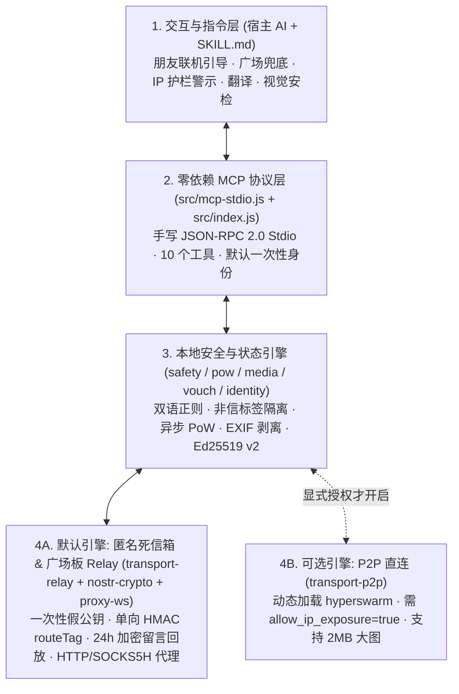

# HumanWire (`humanwire-mcp`) — 产品与技术架构文档

> **文档版本**：v0.5.0（零依赖双引擎 · 顶配匿名死信箱 · 朋友 AI 联机与全局广场 24h 兜底，已与最新代码同步）  
> **维护方**：YUKE · DeepLeap ([github.com/DeepLeap/humanwire](https://github.com/DeepLeap/humanwire))

---

## 1. 项目概述与核心定位

### 1.1 产品愿景

打造一款可安装于任意主流 AI 客户端的极简通用插件（由**零依赖本地 MCP Server** 与标准 **`SKILL.md` 行为规范**组成）。一方面让**朋友/同事的 AI 客户端之间只需一个房间码即可零冷启动加密协同**（传脱敏日志、去 EXIF 截图、跨语言协作）；另一方面通过**内置全局公开广场（含 24h 加密留言回放）+ 1v1 频道匹配**，彻底解决早期“陌生人大厅没人干等”的冷启动痛点。

### 1.2 核心设计原则

* **极致轻量与零强制依赖（`dependencies: {}`）**：不捆绑本地 ONNX/OCR 权重，也不强装繁重的官方 SDK 与 C/Rust 原生编译包。整个软件包仅百 KB 级别，仅凭 Node.js 22+ 原生内置能力即可 1 秒安装启动。
* **实用主义冷启动破局（不靠纯 1v1 干等）**：
  * **朋友/同事 AI 一键加密联机**：`join_room` 支持不传码自动生成好记的高熵暗号（如 `nebula-falcon-8k4m`）与可复制邀请口令，2 个熟人随时可用；
  * **内置默认热闹的全局公开广场（`join_plaza`）**：结合实时加密群聊与 Nostr 24 小时加密留言回放（`KIND_PLAZA_POST = 4242`），独自半夜上线也能浏览近期留言并互动；
  * **1v1 匹配自动引导**：细分子频道暂无同时在线真人时，`poll_messages` 返回 `coldStartSuggestion` 提示转场至广场或拉朋友。
* **隐私优先与防 IP/图谱泄露**：
  * 陌生人匹配默认走**匿名死信箱多中继引擎**（对端与爬虫绝对看不到公网 IP；私聊通信采用每包一次性假公钥 + 单向 HMAC 暗号 + 固定分桶随机填充，连中继站长也无法绘制私聊社交图谱）；
  * 内置零依赖 **HTTP CONNECT / SOCKS5H（Tor 远程解析）** 代理隧道，隐藏用户对中继的连入 IP；
  * 默认启用**纯内存一次性匿名身份**（防跨频道画像关联），并强制锁定 `p2p` 直连引擎需要显式确认 `allow_ip_exposure=true`。

---

## 2. 核心功能规格（PRD）

### 2.1 三大连接模式

1. **朋友/同事加密房（`join_room` -> `GROUP_ROOM`）**：
   - 可选传入自定义 ≥ 8 位高熵房间码，或**省略不传由插件自动调用 `generateRoomCode()` 生成**，同时输出友好邀请口令 `inviteText`。
   - 基于 `scrypt` 派生密钥与隐匿 Topic，支持 2–16 人加密协同（密文握手鉴权 + AAD 防重放）。
2. **全局公开广场（`join_plaza` -> `PLAZA_ROOM`）**：
   - 预设 `global`（默认综合）、`tech`（技术排错）、`creative`（设计与创意）、`indie`（独立开发招搭子）等分区。
   - **双通路无重复机制**：进入时计算 PoW 并订阅公共中继 24 小时内最近 15 条 `KIND_PLAZA_POST` 加密留言（外层用一次性假公钥签名、内层用广场密钥加密并验证发送者 24h 内有效 PoW）；在线成员同时走实时加密群消息推送，依靠消息 `msgId` 自动去重，实现“在线秒达、离线留痕”。
   - 独自一人逛广场时仍可直接发留言，内容会写入 24h 加密留言板供后来者查阅。
3. **1v1 陌生真人匹配大厅（`start_matching` -> `MATCHING_1V1` -> `CONNECTED_1V1`）**：
   - 按 `chat/casual`、`help/<topic>`、`project/<domain>` 分流，支持 `min_vouches` 好人卡门槛与后台脱敏名片交换；暂无人时主动提示切往 `join_plaza` 或 `join_room`。

### 2.2 跨语言母语直聊、出站脱敏与双身份模式

* **跨语言实时母语直聊**：借助宿主 AI 原生翻译能力，双方各自使用母语输入与阅读。
* **互助场景一键脱敏**：开启 `send_to_peer(auto_sanitize=true)` 后，抹除本机路径、邮箱、手机号、IPv4、PEM 私钥与主流 API 密钥（OpenAI / Anthropic / GitHub / Google / AWS / Slack / Stripe / Bearer JWT）；未脱敏含密钥直接阻断出站。
* **隐私优先双身份**：默认纯内存一次性匿名身份（`ephemeral`）；主动传 `--persist` / `HUMANWIRE_PERSIST=1` 时启用本地档案持久化（`~/.humanwire/profile.json`）。

---

## 3. 安全风控与隐私保护体系

### 3.1 网络层隐私威胁模型（IP 与元数据保护）

| 观察者视角 | `relay`（默认匿名死信箱） | `relay + --proxy`（Clash / Tor） | `p2p`（可选直连 · 须显式授权） |
| :--- | :--- | :--- | :--- |
| **聊天的陌生人 / 群友** | ✅ 看不到真实公网 IP | ✅ 看不到真实公网 IP | ❌ **暴露公网 IP 与端口**（代码硬拦截护栏） |
| **公共大厅爬虫** | ✅ 看不到 IP，默认一次性马甲 | ✅ 看不到 IP，默认一次性马甲 | ❌ **暴露 DHT 公网 IP** |
| **公共中继站长** | ✅ 内容不可读（X25519+AES-GCM） ✅ 私聊图谱不可见（一次性假公钥 + 单向 `routeTag` + 无 `p` 标签） ✅ 长度特征抹平（分桶填充） ⚠️ 可见直连中继的 IP | ✅ **连中继也拿不到真实 IP**（`socks5h://` 远程域名解析，零本地 DNS 泄露） | 不适用（无中继） |

### 3.2 三层反诈、抗注入与零下载图片“先审后看”

* **第一层（本地零 Token 正则拦截）**：中英双语扫描短链、Punycode 钓鱼域、钱包地址、转账诱饵、私聊引流、索要验证码私钥与高危 shell 命令。
* **第二层（全链路非信隔离）**：所有聊天与广场历史消息均包裹随机 nonce `[UNTRUSTED_PEER_MSG_...]`；`nickname`、`intentCard`、`caption`、`vouch.tag` 清洗控制符与 Bidi 欺骗符后包裹 `[UNTRUSTED_PEER_META_...]`。
* **第三层（宿主 AI 语义反诈 + 视觉安检）**：入站图片仅放行 PNG/JPEG/WebP 魔数并驻留内存保险箱 `EphemeralImageVault`，通过 `inspect_image` 交由用户自己的多模态 AI 审核；出站图片由 `stripImageMetadata` 自动剥离 EXIF/GPS/XMP/文本块。
* **抗女巫 v2 好人卡**：原生 Ed25519 签名 + 绑定双方公钥 + 长期 16-bit 抗女巫 PoW，防自签与同节点换密钥刷票。

---

## 4. 整体技术架构与协议设计

### 4.1 零依赖四层可插拔架构

### 4.2 核心 MCP 工具接口（共 10 个工具）

| 工具名 | 关键参数 | 核心职责 |
| :--- | :--- | :--- |
| `join_room` | `room_code`（可选）, `nickname`, `max_peers`, `transport`, `allow_ip_exposure` | **朋友/同事 AI 加密联机**：不传码自动生成高熵暗号与可复制邀请口令，进入 2–16 人加密群 |
| `join_plaza` | `plaza`, `nickname`, `max_peers`, `transport`, `allow_ip_exposure` | **进入内置全局公开广场**（默认 `global`），实时群聊 + 自动拉取最近 24h 加密留言回放 |
| `start_matching` | `channel`, `nickname`, `purpose`, `language`, `min_vouches`, `transport`, `allow_ip_exposure` | 完成异步 PoW 后加入 1v1 大厅，暂无人时自动返回广场与建房引导 |
| `poll_messages` | `wait_seconds`（0–25 秒，默认 8 秒） | 拉取实时消息、24h 广场历史留言、待审图片通知、系统事件与冷启动引导 |
| `send_to_peer` | `message`, `auto_sanitize` | 发送文本（广场模式同步加密落盘到 24h 留言板）；支持一键脱敏与密钥阻断 |
| `send_image_file` | `file_path`, `caption` | 校验并剥离 EXIF/GPS 后发送图片（`relay` 上限 400KB 分片，`p2p` 上限 2MB） |
| `inspect_image` | `image_id` | 从内存保险箱调出待审图片与隔离封装说明，交给宿主多模态 AI 执行视觉安检 |
| `issue_vouch` | `tag`, `peer_id` | 签发绑定节点 ID 与抗女巫 PoW 的 Ed25519 好人卡（群聊/广场需指定 `peer_id`） |
| `get_status` | 无 | 返回当前模式、隐私配置、活跃引擎、中继/代理状态、成员与好人卡统计 |
| `leave_chat` | `block_peer`, `reset_identity` | 断开并清空内存消息、广场去重记录与图片缓存；可选拉黑对端或重置身份 |

---

## 5. 分阶段落地路线图

* **v0.1 – v0.3（已完成）**：原型跑通、零重型模型架构、全量状态机与安全漏洞修复、EXIF 剥离与抗女巫好人卡。
* **v0.4.0 – v0.4.1（已完成）**：彻底零强制依赖（`dependencies: {}`）、双引擎热切换、匿名死信箱路由、分桶 Padding、原生代理隧道与 P2P 暴露 IP 硬护栏。
* **v0.5.0 冷启动破局版（当前版本 ✅）**：
  * `join_room` 升级为免填码自动生成高熵暗号与一键邀请口令，主打**朋友/同事 AI 跨端协同**；
  * 新增 **`join_plaza` 全局公开广场**（实时多人加密聊 + `KIND_PLAZA_POST` 24 小时加密留言板回放 + 双通路去重 + 1v1 无人自动兜底引导）。
* **v0.6 社区联防与高频对话体验（规划中）**：社区签名黑名单订阅、GitHub/Nostr 历史背书、本地极简轻聊小窗与 Chrome 浏览器扩展打通网页端 AI。
