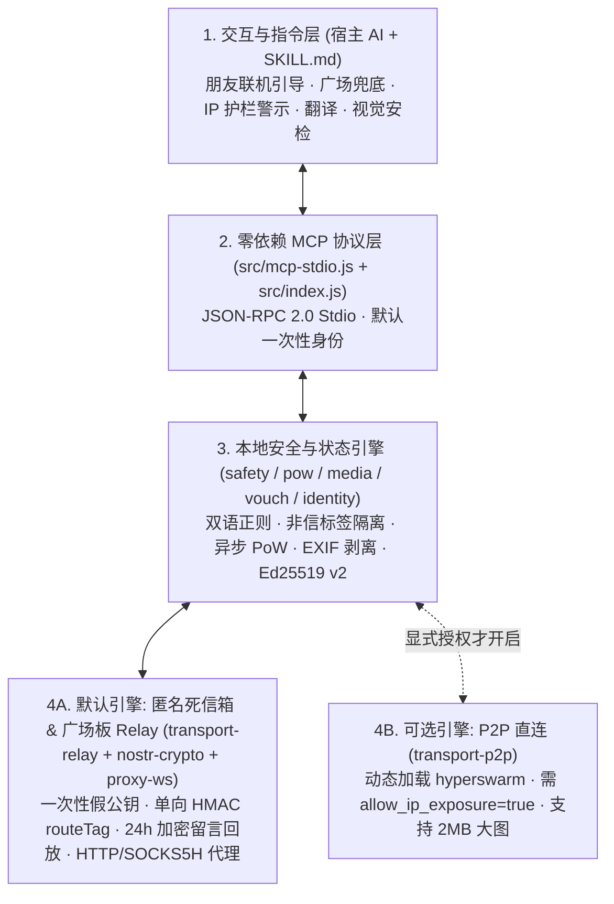

# HumanWire (`humanwire-mcp`) — 产品与技术架构文档

> **功能基线** v0.5.1，包含当前工作区的匹配与收信改进
>
> **维护方**：YUKE · DeepLeap ([github.com/DeepLeap/humanwire](https://github.com/DeepLeap/humanwire))

---

## 1. 项目概述与核心定位

### 1.1 产品愿景

HumanWire 让用户按兴趣匹配在线陌生人，一对一聊天、认识新朋友或寻找项目同好。用户可以直接打开本地聊天小窗，也可以让兼容 MCP 的 AI 客户端发起匹配。熟人房间和公开广场提供额外的交流入口。不同宿主的能力和接法见[客户端接入原理](./INTEGRATION.md)。

### 1.2 核心设计原则

* **兴趣匹配**：允许用户或 AI 提供公开关键词，双方至少有一个归一后的词相同才匹配。匹配机会取决于同时在线的用户。
* **界面和模型分开收发**：小窗独立展示文本，标准 MCP 模式通过宿主调用工具转发。
* **默认接入**：Node.js 22+ 标准库运行中继模式。中继路径避免向聊天对端直接暴露公网 IP，运营方可观察其连接端点与路由元数据。支持 HTTP CONNECT / SOCKS5H 代理，直连须显式同意。

---

## 2. 核心功能规格（PRD）

### 2.1 三大连接模式

1. **朋友/同事加密房（`join_room` -> `GROUP_ROOM`）**：
   - 可选传入自定义 ≥ 8 位高熵房间码，或**省略不传由插件自动调用 `generateRoomCode()` 生成**，同时输出友好邀请口令 `inviteText`。
   - 基于 `scrypt` 派生密钥与隐匿 Topic，支持 2–16 人加密协同（密文握手鉴权 + AAD 防重放）。
2. **全局公开广场（`join_plaza` -> `PLAZA_ROOM`）**：
   - 预设 `global`（默认综合）、`tech`（技术排错）、`creative`（设计与创意）、`indie`（独立开发招搭子）等分区。
   - **双通路无重复机制**：进入时计算 PoW 并订阅公共中继 24 小时内最近 15 条 `KIND_PLAZA_POST` 加密留言（外层用一次性假公钥签名、内层用广场密钥加密并验证发送者 24h 内有效 PoW）；在线成员同时走实时加密群消息推送，依靠消息 `msgId` 自动去重，实现“在线秒达、离线留痕”。
   - 独自一人逛广场时仍可直接发留言，内容会写入 24h 加密留言板供后来者查阅。
3. **1v1 陌生真人匹配大厅（`start_matching` -> `MATCHING_1V1` -> `CONNECTED_1V1`）**：
   - 传入 `keywords` 时按公开兴趣词取交集。沿用精确频道时可使用 `chat/casual`、`help/<topic>` 或 `project/<domain>`，并支持 `min_vouches` 门槛。两种发现路径各自匹配。

### 2.2 跨语言母语直聊、出站脱敏与双身份模式

* **跨语言聊天**：小窗可使用兼容浏览器的本地翻译，原生 MCP 路径可以由宿主模型协助翻译。
* **互助场景一键脱敏**：开启 `send_to_peer(auto_sanitize=true)` 后，抹除本机路径、邮箱、手机号、IPv4、PEM 私钥与主流 API 密钥（OpenAI / Anthropic / GitHub / Google / AWS / Slack / Stripe / Bearer JWT）；未脱敏含密钥直接阻断出站。
* **隐私优先双身份**：默认纯内存一次性匿名身份（`ephemeral`）；主动传 `--persist` / `HUMANWIRE_PERSIST=1` 时启用本地档案持久化（`~/.humanwire/profile.json`）。

---

## 3. 安全风控与隐私保护体系

### 3.1 网络层隐私威胁模型（IP 与元数据保护）

| 观察者视角 | `relay`（默认匿名死信箱） | `relay + --proxy`（Clash / Tor） | `p2p`（可选直连 · 须显式授权） |
| :--- | :--- | :--- | :--- |
| **聊天的陌生人 / 群友** | ✅ 看不到真实公网 IP | ✅ 看不到真实公网 IP | ❌ **暴露公网 IP 与端口**（代码硬拦截护栏） |
| **公共大厅爬虫** | ✅ 看不到 IP，默认一次性马甲 | ✅ 看不到 IP，默认一次性马甲 | ❌ **暴露 DHT 公网 IP** |
| **公共中继站长** | 私聊正文加密。可观察连入 IP、发布与订阅标签、时间等连接元数据。分桶填充可减少长度细节。 | 中继看到代理出口 IP。`socks5h://` 使用代理端域名解析。 | 不适用（无中继） |

公开广场使用可由广场名称推导的密钥，内容应视为公开。

### 3.2 三层反诈、抗注入与零下载图片“先审后看”

* **第一层（本地零 Token 正则拦截）**：中英双语扫描短链、Punycode 钓鱼域、钱包地址、转账诱饵、私聊引流、索要验证码私钥与高危 shell 命令。
* **第二层（外部数据标记）**：原生 MCP 工具为外部消息添加 `[UNTRUSTED_PEER_MSG_...]` 等标记，提示模型按外部数据处理。小窗直接以纯文本显示消息。
* **第三层（宿主 AI 语义反诈 + 视觉安检）**：入站图片仅放行 PNG/JPEG/WebP 魔数并驻留内存保险箱 `EphemeralImageVault`，通过 `inspect_image` 交由用户自己的多模态 AI 审核；出站图片由 `stripImageMetadata` 自动剥离 EXIF/GPS/XMP/文本块。
* **抗女巫 v2 好人卡**：原生 Ed25519 签名 + 绑定双方公钥 + 长期 16-bit 抗女巫 PoW，防自签与同节点换密钥刷票。

---

## 4. 整体技术架构与协议设计

### 4.1 零依赖四层可插拔架构

### 4.2 核心 MCP 工具接口

| 工具名 | 关键参数 | 核心职责 |
| :--- | :--- | :--- |
| `join_room` | `room_code`（可选）, `nickname`, `max_peers`, `transport`, `allow_ip_exposure` | **朋友/同事 AI 加密联机**：不传码自动生成高熵暗号与可复制邀请口令，进入 2–16 人加密群 |
| `join_plaza` | `plaza`, `nickname`, `max_peers`, `transport`, `allow_ip_exposure` | **进入内置全局公开广场**（默认 `global`），实时群聊 + 自动拉取最近 24h 加密留言回放 |
| `start_matching` | `keywords` 或 `channel`, `nickname`, `purpose`, `language`, `timeout_seconds`, `min_vouches`, `transport`, `allow_ip_exposure` | 按公开兴趣寻找一个人，默认等待 60 秒，超时后可继续寻找 |
| `retry_matching` | 无 | 超时或断线后沿用上次偏好开始新会话 |
| `open_chat_window` | 无 | 小窗模式中重新打开当前会话，发起匹配时也会自动请求打开 |
| `poll_messages` | `wait_seconds`（0–25 秒，默认 8 秒） | 拉取实时消息、24h 广场历史留言、待审图片通知、系统事件与冷启动引导 |
| `send_to_peer` | `message`, `auto_sanitize` | 发送文本，支持脱敏与密钥阻断。广场模式还会向中继发布加密留言，留存取决于中继 |
| `send_image_file` | `file_path`, `caption` | 校验并剥离 EXIF/GPS 后发送图片（`relay` 上限 400KB 分片，`p2p` 上限 2MB） |
| `inspect_image` | `image_id` | 从内存保险箱调出待审图片与隔离封装说明，交给宿主多模态 AI 执行视觉安检 |
| `issue_vouch` | `tag`, `peer_id` | 签发绑定节点 ID 与抗女巫 PoW 的 Ed25519 好人卡（群聊/广场需指定 `peer_id`） |
| `manage_blocklist` | `action`, `peer_id` | 查看、添加或解除节点屏蔽，指定节点时使用完整公钥 |
| `clear_media_vault` | 无 | 清空收到的图片，保留当前会话与文字 |
| `get_status` | 无 | 返回当前模式、隐私配置、活跃引擎、中继/代理状态、成员与好人卡统计 |
| `leave_chat` | `block_peer`, `reset_identity` | 断开并清空内存消息、广场去重记录与图片缓存；可选拉黑对端或重置身份 |

工具会随接入方式提供。小窗模式通过本地显示接口收发正文，原生 MCP 模式提供文字与图片工具。当前会话最多保留 200 条显示事件，显式结束或重新匹配时清空。宿主接法与游标约定见[接入指南](INTEGRATION.md)。

---

## 5. 版本里程碑

- **v0.1 – v0.3** 完成匹配与聊天原型、会话状态机、图片 EXIF 清理与好人卡。
- **v0.4.0 – v0.4.1** 移除强制运行时依赖，提供中继与可选直连、匿名死信箱路由、分桶填充、代理隧道和直连 IP 暴露确认。
- **v0.5.0** 增加自动生成房间码、全局公开广场，以及匹配不到人时的指引。广场可读取中继返回的最近 24 小时范围内的留言。
- **v0.5.1** 加入公开关键词匹配和本地聊天小窗。运行 `npm run chat` 可以打开独立小窗，进行匹配、加入房间和收发文字。浏览器支持时可使用本地翻译。

待办、负责人、当前进度和验收条件见[开发路线图与协作进度](ROADMAP.md)。
