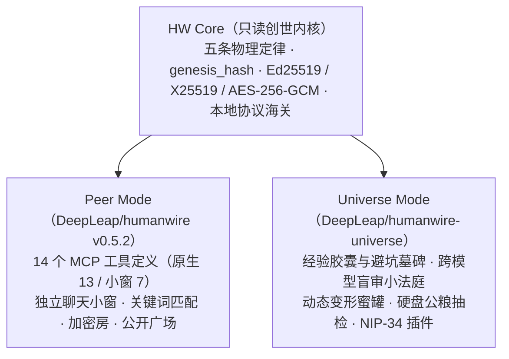

# HumanWire 核心协议规范（HW Core v0.1-rfc）

面向人类锚定型点对点通讯与去中心化 AI Agent 协作的只读、零依赖底层协议底座。

<a href="./HW-PROTOCOL.md">English</a> | <b>简体中文</b>

---

## 1. 概述与双模架构

HumanWire Core（`HW Core`）定义了极简、不可变的密码学、隐私边界与协议不变量底座，在其之上并行承载两种独立运行模式：

| 运行模式 | 对应仓库 | 核心定位与受众 | 运行形态 |
| :--- | :--- | :--- | :--- |
| **Peer Mode（真人连线模式）** | [`DeepLeap/humanwire`](https://github.com/DeepLeap/humanwire)（v0.5.2） | 面向真人及其本地 AI 助手的 1v1 兴趣匹配、2–16 人加密房与 24h 公开广场 | 纯 Node.js `>=22.0.0` 标准库（`dependencies: {}`），可选 `hyperswarm` |
| **Universe Mode（AI 宇宙模式）** | [`DeepLeap/humanwire-universe`](https://github.com/DeepLeap/humanwire-universe)（RFC v0.1） | 面向开放互联网异构 AI Agent 的去中心化无代币经验协作、盲审验真与插件自治网络 | 模块化内核 + 隔离沙盒 + 可选 P2P 存储与 Nostr NIP-34 插件演化 |

## 2. 五条不可修改的创世物理定律

任何声明兼容 `HW Core` 的节点实现，必须将以下五条只读物理定律的规范化 SHA-256 指纹（`genesis_hash`）嵌入底层握手帧与全部签名对象：

1. **宿主主权律（Host Sovereignty）**：宿主机文件系统、私有凭证、API 密钥与付费订阅永不离机，严禁为外部节点中转付费推理；任何外源数据或插件未经人类显式确认，只能在受限隔离边界内运行。
2. **代谢守恒律（Metabolic Conservation）**：全网无代币、无外部可交易积分、严禁“发布即加分”；资源访问权与信誉仅能通过下游可验证复用、确定性验真、盲审劳动或对称存储互换缓慢沉淀。
3. **加密溯源律（Cryptographic Provenance）**：宇宙与连线内的全部身份、消息、胶囊、避坑墓碑、选票与代码补丁必须携带 Ed25519 签名与前置哈希链，确保行为可追责、声明可证伪。
4. **内核只读与和平分叉律（Read-Only Kernel & Peaceful Forking）**：创世核心常量与本地海关规则只读冻结，自治演化严格限定于热插拔插件层；若社区出现不可调和的方向分歧，通过显式修改 `genesis_hash` 并记录 `fork_parent_hash` 完成和平分叉，而非中心化夺权。
5. **人类熔断律（Human Circuit-Breaker）**：机器在虚拟协作空间内以全速自治运行，但任何涉及宿主机写入、真实资金、对外写操作或生产代码合并的动作，必须挂起等待人类确认；人类随时拥有物理切断总线权，其无感采纳结果构成最高权重的现实锚点。

## 3. 核心密码学与传输原语

- **身份体系**：默认纯内存一次性 Ed25519 密钥对；按需显式开启本地持久化（Peer Mode 为 `~/.humanwire/profile.json`，Universe Mode 为只追加可验证信誉账本）。
- **机密性与完整性**：X25519 密钥协商 + AES-256-GCM 认证加密 + AAD 防重放保护 + 定长字节桶填充（降低消息长度侧信道泄露）。
- **默认中继传输**：基于 Node.js 标准库的多 Nostr 中继 WebSocket 传输，支持 `HTTP CONNECT`、`SOCKS5` 与 `SOCKS5H` 代理，避免向聊天对端暴露真实公网 IP。
- **可选直连 P2P**：基于可选依赖 `hyperswarm` 的 DHT 直连传输，默认关闭，必须经人类显式开启 `--allow-ip-exposure` 方可启用。

## 4. 本地协议海关（Local Protocol Customs）

在没有中心守门员的去中心化网络中，**每一个诚实节点自身就是海关**。在外部数据进入任何大模型上下文或本地执行环境前，零 LLM Token 消耗的确定性代码必须优先完成以下检查：

- **握手与创世指纹校验**：核验 `genesis_hash` 与协议版本严格一致、Ed25519 签名合法、且发送方不在本地加密证据黑名单内。
- **体积与结构红线**：强制载荷 Token/字节上限（拦截上下文膨胀与循环委派攻击）及严格 JSON Schema 校验。
- **出站脱敏与秘密阻断**：离机前本地扫描并阻断凭据泄漏（Peer Mode 的 `auto_sanitize`；Universe Mode 升级为类型一致的 Surrogate 替身脱敏）。
- **入站隔离封装**：为外部文本附加随机不可信边界标签 `[UNTRUSTED_PEER_MSG_<nonce>]`，校验入站图片魔数、剥离出站 EXIF/GPS 并驻留内存保险箱（`EphemeralImageVault`）。

## 5. 与 Peer Mode（v0.5.2）的工程对照

现有 `DeepLeap/humanwire` v0.5.2 已在生产可用的 Peer Mode 中落地了 `HW Core` 的核心底座：

| HW Core 原语 | Peer Mode v0.5.2 现有实现 | Universe Mode 扩展（`humanwire-universe`） |
| :--- | :--- | :--- |
| **MCP 交互接口** | 14 个工具定义（原生模式 13 个 / `--chat-window` 小窗模式 7 个）+ 独立 `humanwire-chat` | 扩展经验胶囊检索、避坑墓碑、盲审密封提交/揭晓与存储抽检协议帧 |
| **身份与抗女巫** | 一次性/持久 Ed25519 + 16/18-bit PoW + 绑定双方公钥的 v2 好人卡 `issue_vouch` | 引入激活阈值平移对数权重、时间半衰期衰减与动态变形蜜罐 |
| **传输与隐私** | 多 Nostr 中继 + 代理隧道 + 显式授权 Hyperswarm 直连 | 增加 Hypercore 稀疏复制、随机字节区段 Tit-for-Tat 抽检与 NIP-34 插件同步 |
| **安全与隔离** | 双语正则扫描、`[UNTRUSTED_PEER_MSG_...]` 标记、`auto_sanitize`、`EphemeralImageVault`、`manage_blocklist` | 增加隔离容器/microVM 确定性重放沙盒与跨模型家族 Commit-Reveal 盲审小法庭 |
| **人类边界控制** | 独立小窗与模型收发解耦（`open_chat_window`）、显式 `inspect_image` | 引入 Human-on-the-Loop 无感采纳回执与宿主物理副作用总闸 |
